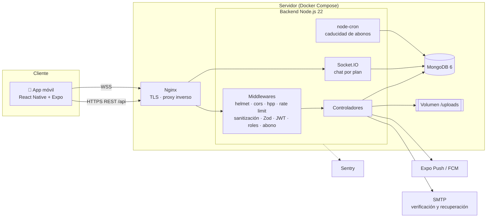
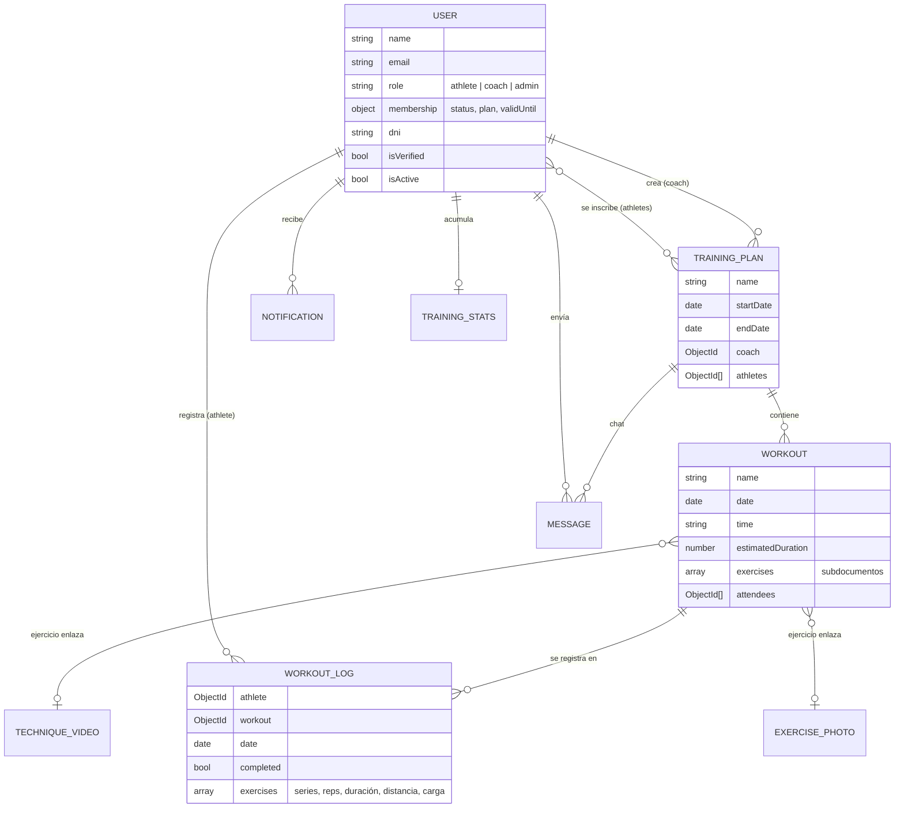
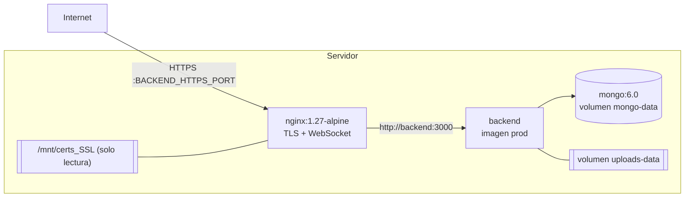

# Bulderland · Backend

[](https://github.com/diegolasherasGit/TFG-EntrenamientoApp-Backend/actions/workflows/ci.yml)


Servidor de la aplicación móvil de entrenamientos de **Bulderland**, un centro de escalada. Expone una API REST y un canal en tiempo real (Socket.IO). Con ellos los entrenadores del centro diseñan planes de entrenamiento, los atletas se inscriben y registran sus resultados, y ambos se comunican por chat y notificaciones *push*. El acceso al contenido de entrenamiento depende de un abono que activa el administrador y que caduca solo con una tarea programada.

> Trabajo Fin de Grado · Grado en Ingeniería Informática · Escuela de Ingeniería y Arquitectura, Universidad de Zaragoza (septiembre de 2026).
> *Desarrollo del sistema base y módulo de gestión de entrenamientos para una aplicación móvil de escalada.*
> Autor: **Diego Lasheras Blasco** · Director: Ricardo Julio Rodríguez Fernández · Codirector: Rafael Galán Rodríguez.

La aplicación móvil está en un repositorio aparte: **[TFG-EntrenamientoApp-Mobile](https://github.com/diegolasherasGit/TFG-EntrenamientoApp-Mobile)**. Allí están también los [vídeos de demostración](https://github.com/diegolasherasGit/TFG-EntrenamientoApp-Mobile#-vídeos-de-demostración) de cada rol.

---

## Índice

- [Demostración](#-demostración)
- [Funcionalidades](#-funcionalidades)
- [Arquitectura](#-arquitectura)
- [Stack tecnológico](#-stack-tecnológico)
- [Estructura del proyecto](#-estructura-del-proyecto)
- [Modelo de datos](#-modelo-de-datos)
- [API REST](#-api-rest)
- [Chat en tiempo real (Socket.IO)](#-chat-en-tiempo-real-socketio)
- [Seguridad](#-seguridad)
- [Puesta en marcha en local](#-puesta-en-marcha-en-local)
- [Variables de entorno](#-variables-de-entorno)
- [Datos de prueba (seeds)](#-datos-de-prueba-seeds)
- [Pruebas](#-pruebas)
- [Integración continua](#-integración-continua)
- [Despliegue en producción](#-despliegue-en-producción)
- [Scripts disponibles](#-scripts-disponibles)
- [Licencia](#-licencia)

---

## 🎬 Demostración

Cada vídeo es una cadena: lo que crea el administrador lo usa el entrenador, y lo de los dos lo usa la atleta. Pincha en la vista previa para ver el vídeo completo.

| Administrador | Entrenador | Atleta |
|:---:|:---:|:---:|
| <a href="https://github.com/diegolasherasGit/TFG-EntrenamientoApp-Mobile/blob/main/docs/videos/rol-admin.mp4"></a> | <a href="https://github.com/diegolasherasGit/TFG-EntrenamientoApp-Mobile/blob/main/docs/videos/rol-entrenador.mp4"></a> | <a href="https://github.com/diegolasherasGit/TFG-EntrenamientoApp-Mobile/blob/main/docs/videos/rol-atleta.mp4"></a> |

---

## ✨ Funcionalidades

### Por rol

| Rol | Qué puede hacer |
|---|---|
| **Atleta** (`athlete`) | Se registra él mismo y verifica el correo con un código de 6 dígitos. Solicita el abono aportando su DNI. Con el abono activo: explora los planes, se inscribe, consulta su calendario, marca asistencia, registra cada sesión ejercicio a ejercicio, ve su progreso y estadísticas, chatea con su entrenador y consulta la videoteca de técnica. |
| **Entrenador** (`coach`) | Crea, edita, duplica y borra planes de entrenamiento y sus sesiones, con ejercicios por repeticiones, tiempo o distancia, intensidad, carga, descanso, vídeo de técnica y foto. Ve el progreso de cada atleta del plan, sus registros y un panel con la actividad semanal del equipo. Exporta todo a **Excel** y chatea con sus atletas. No necesita abono. |
| **Administrador** (`admin`) | Da de alta a entrenadores y a otros administradores. Gestiona los abonos: revisa las solicitudes pendientes con el DNI y activa el abono mensual, trimestral o anual. Busca, borra y restaura usuarios (borrado lógico). Mantiene la videoteca de técnica y la biblioteca de fotos de ejercicios, y consulta las estadísticas de la plataforma. |

> El administrador **no** crea atletas a propósito: el alta de atletas es de autoservicio desde la app.

### Transversales

- **Autenticación** con JWT (correo y contraseña, o Google Sign-In), verificación de correo y recuperación de contraseña con códigos de 6 dígitos enviados por email.
- **Control de acceso por abono**: el middleware `requireActiveMembership` devuelve `403` con el código `NO_ACTIVE_MEMBERSHIP` y la app muestra la pantalla de solicitud. Cada día a las 03:00 (Europe/Madrid) un *cron* caduca los abonos vencidos. También hace una pasada al arrancar, por si el servidor estuvo caído a esa hora.
- **Chat por plan** en tiempo real con Socket.IO, con historial persistido y borrado del propio mensaje.
- **Notificaciones** en la app y ***push*** (Expo Push / FCM): sesión modificada, mensaje nuevo, solicitud de abono, etc.
- **Estadísticas**: panel del atleta (sesiones, horas, progreso por ejercicio), panel del entrenador (actividad semanal del equipo: sesiones programadas frente a completadas) y panel del administrador (métricas de la plataforma).
- **Exportación a Excel** (`exceljs`): una hoja de estadísticas por atleta y una hoja de detalle por atleta, con una fila por ejercicio registrado.
- **Borrado lógico** (*soft-delete*) en todos los modelos mediante un *plugin* global de Mongoose.
- **Subida de imágenes** (foto de perfil y fotos de ejercicios), validadas por tipo MIME y tamaño y servidas desde `/uploads`.
- **Documentación interactiva** de la API con Swagger UI en `/api-docs`.
- **Monitorización de errores** con Sentry (opcional) y logs estructurados con Winston y Morgan.

---

## 🏛 Arquitectura



El código sigue una arquitectura por capas (*routes → middlewares → controllers → models*):

1. **Rutas** (`src/routes`): declaran los *endpoints* y encadenan los middlewares de cada uno.
2. **Middlewares** (`src/middleware`): `protect` (JWT), `restrictTo(...roles)`, `requireActiveMembership`, `validate(schema)` (Zod) y el manejador global de errores.
3. **Controladores** (`src/controllers`): lógica de negocio, envueltos en `catchAsync`. Los errores de dominio se lanzan como `AppError`.
4. **Modelos** (`src/models`): esquemas de Mongoose con el *plugin* de borrado lógico.
5. **Utilidades** (`src/utils`): acceso a planes, notificaciones *push*, email, subida de imágenes, validación de DNI/NIE, etc.

---

## 🧰 Stack tecnológico

| Área | Tecnología |
|---|---|
| Entorno | Node.js 22 (ES Modules), pnpm 11 |
| Framework HTTP | Express 5 |
| Base de datos | MongoDB 6 + Mongoose 9 |
| Tiempo real | Socket.IO 4 |
| Validación | Zod 4 |
| Autenticación | jsonwebtoken, bcryptjs, google-auth-library |
| Seguridad | helmet, cors, hpp, express-rate-limit, mongo-sanitize |
| Notificaciones | expo-server-sdk (Expo Push / FCM), nodemailer |
| Tareas programadas | node-cron |
| Exportación | exceljs |
| Documentación | swagger-jsdoc + swagger-ui-express |
| Observabilidad | Sentry, Winston, Morgan |
| Pruebas | Jest 30 + Supertest + socket.io-client |
| Calidad | ESLint 9 + Prettier |
| Infraestructura | Docker, Docker Compose, Nginx |

---

## 📂 Estructura del proyecto

```
TFG-EntrenamientoApp-Backend/
├── .github/workflows/ci.yml     # Integración continua (lint, tests, imagen Docker)
├── nginx/default.conf           # Proxy inverso HTTPS + WebSocket (producción)
├── Dockerfile                   # Multietapa: base → dev (nodemon) / prod
├── docker-compose.dev.yml       # Backend + Mongo para desarrollo
├── docker-compose.prod.yml      # Backend + Nginx + Mongo para producción
├── src/
│   ├── index.js                 # Arranque: HTTP + Socket.IO + scheduler de abonos
│   ├── app.js                   # App de Express: middlewares de seguridad y rutas
│   ├── instrument.js            # Inicialización de Sentry
│   ├── config/                  # db, cors, logger, socket, swagger
│   ├── constants/               # roles, estados y tipos de abono, categorías de ejercicio
│   ├── routes/                  # Un router por recurso (+ anotaciones Swagger)
│   ├── middleware/              # auth (protect, restrictTo, requireActiveMembership), validate, errores
│   ├── schemas/                 # Esquemas Zod de entrada por recurso
│   ├── controllers/             # Lógica de negocio por recurso
│   ├── models/
│   │   ├── User.js, Message.js, Notification.js, TrainingStats.js, TechniqueVideo.js, ExercisePhoto.js
│   │   ├── templates/           # TrainingPlan, Workout (lo que diseña el entrenador)
│   │   ├── logs/                # WorkoutLog (lo que registra el atleta)
│   │   └── plugins/softDelete.js
│   ├── utils/                   # AppError, catchAsync, ApiFeatures, push, email, DNI, planAccess…
│   ├── scripts/                 # Seeds: general, Maestro, demo del entrenador, admin inicial
│   └── tests/                   # Jest: controladores, middlewares, utilidades
└── uploads/                     # Imágenes subidas (ignoradas por git)
```

---

## 🗃 Modelo de datos



- **Plantillas frente a registros**: `TrainingPlan` y `Workout` son lo que diseña el entrenador. `WorkoutLog` es lo que ejecuta y registra cada atleta. Separarlos permite comparar lo planificado con lo realizado.
- **Ejercicios**: subdocumentos dentro de `Workout`, con `type` (calentamiento, movilidad, fuerza, resistencia, escalada, técnica, estiramientos, otro) y parámetros flexibles según el tipo de seguimiento (`reps`, `time`, `distance`).
- **Abono** (`User.membership`): `status` ∈ `none | pending | active | expired`, `plan` ∈ `mensual (30 d) | trimestral (90 d) | anual (365 d)` y `validUntil`, que se calcula solo al activarlo.
- **Borrado lógico**: todas las colecciones tienen `isActive` y las consultas filtran `isActive: true` de forma automática. Un documento insertado a mano sin ese campo **no** lo verá la app.

---

## 🔌 API REST

Base: `/api`. Todas las rutas, salvo las de autenticación, requieren `Authorization: Bearer <token>`. La referencia completa, con esquemas y ejemplos, está en Swagger: **`http://localhost:3000/api-docs`**.

Leyenda de acceso: **Público** · **Auth** (cualquier usuario autenticado) · **Abono** (atleta con abono activo; entrenador y administrador exentos) · **Coach** / **Admin**.

### Usuarios — `/api/users`

| Método | Ruta | Acceso | Descripción |
|---|---|---|---|
| POST | `/register` | Público | Registro de atleta (envía código de verificación) |
| POST | `/verify-email` | Público | Verifica el correo con el código OTP |
| POST | `/login` | Público | Inicio de sesión; devuelve JWT |
| POST | `/google-login` | Público | Inicio de sesión con Google (ID token) |
| POST | `/forgot-password` | Público | Envía por email un código de recuperación (caduca en 15 min) |
| POST | `/reset-password` | Público | Restablece la contraseña con ese código |
| GET | `/membership` | Auth | Estado del abono propio |
| POST | `/membership/request` | Auth | Solicita el abono aportando DNI/NIE |
| GET · PUT · DELETE | `/profile/:id` | Auth | Ver, editar o darse de baja (propio; admin, cualquiera) |
| POST · DELETE | `/profile/:id/photo` | Auth | Subir o quitar la foto de perfil |
| GET | `/` | Admin | Listado y búsqueda de usuarios |
| GET | `/deleted` | Admin | Usuarios borrados (lógicamente) |
| PATCH | `/profile/:id/restore` | Admin | Restaurar un usuario borrado |
| POST | `/privileged` | Admin | Crear entrenador o administrador |
| PATCH | `/profile/:id/membership` | Admin | Activar o desactivar el abono (mensual, trimestral o anual) |

### Planes de entrenamiento — `/api/training/plans`

| Método | Ruta | Acceso | Descripción |
|---|---|---|---|
| GET | `/` | Abono | Planes activos (explorar) |
| POST | `/` | Coach/Admin | Crear plan |
| GET | `/:id` | Abono | Detalle de un plan |
| PUT · DELETE | `/:id` | Coach/Admin | Editar o borrar plan (el propio) |
| POST | `/:id/enroll` | Abono | Inscribirse en el plan |
| POST | `/:id/duplicate` | Coach/Admin | Duplicar el plan con sus sesiones |
| GET | `/:id/athletes-progress` | Coach/Admin | Qué atletas del plan tienen sesiones completadas |
| GET | `/athlete/:athleteId` | Abono | Planes de un atleta |
| GET | `/coach/:coachId` | Abono | Planes de un entrenador |
| GET · POST | `/:planId/chat` | Auth | Historial del chat y envío de un mensaje |
| DELETE | `/:planId/chat/:messageId` | Auth | Borrar el propio mensaje |

### Sesiones — `/api/training/workouts`

| Método | Ruta | Acceso | Descripción |
|---|---|---|---|
| POST | `/` | Coach/Admin | Crear sesión con sus ejercicios |
| GET | `/plan/:planId` | Abono | Sesiones de un plan |
| GET | `/calendar/my-calendar` | Abono | Calendario del usuario autenticado |
| GET | `/:id` | Abono | Detalle de una sesión |
| PUT · DELETE | `/:id` | Coach/Admin | Editar o borrar (notifica a los atletas) |
| POST | `/:id/duplicate` | Coach/Admin | Duplicar en otra fecha |
| POST · DELETE | `/:id/attend` | Abono | Confirmar o anular asistencia |

### Registros de ejecución — `/api/training/logs`

| Método | Ruta | Acceso | Descripción |
|---|---|---|---|
| POST | `/` | Abono | Registrar el resultado de una sesión |
| GET | `/athlete/:athleteId` | Abono | Registros de un atleta (el propio, o los de los planes del entrenador) |
| GET | `/export/coach` | Coach | Exportación a Excel de los registros de sus atletas |
| PUT · DELETE | `/:id` | Abono | Editar o borrar un registro |

### Estadísticas — `/api/training/stats`

| Método | Ruta | Acceso | Descripción |
|---|---|---|---|
| GET | `/dashboard` | Abono | Panel según el rol (atleta, entrenador o administrador) |
| GET | `/progress/:userId` | Abono | Progreso por ejercicio |
| POST · GET · PUT · DELETE | `/` · `/user/:userId` | Abono | Estadísticas acumuladas (PRs, volumen) |

### Biblioteca de técnica y fotos

| Método | Ruta | Acceso | Descripción |
|---|---|---|---|
| GET | `/api/technique-videos` · `/:id` | Auth | Videoteca de técnica (filtrable por categoría) |
| POST · PUT · DELETE | `/api/technique-videos[/:id]` | Admin | Gestión de la videoteca |
| GET | `/api/exercise-photos` · `/:id` | Auth | Biblioteca de fotos de ejercicios |
| POST · PUT · DELETE | `/api/exercise-photos[/:id]` | Admin | Gestión de la biblioteca de fotos |

### Notificaciones — `/api/notifications`

| Método | Ruta | Acceso | Descripción |
|---|---|---|---|
| GET | `/` | Auth | Notificaciones del usuario |
| PATCH | `/read-all` · `/:id/read` | Auth | Marcar como leídas |
| DELETE | `/:id` | Auth | Borrar una notificación |

### Errores

Todas las respuestas de error tienen la forma `{ "status": "fail" | "error", "message": "…" }`. Los errores de validación de Zod devuelven `400` con el detalle de cada campo. `401` indica sesión ausente, inválida o caducada. `403` indica rol no autorizado o, con `code: "NO_ACTIVE_MEMBERSHIP"`, que falta el abono.

---

## 💬 Chat en tiempo real (Socket.IO)

El servidor de Socket.IO comparte puerto con la API y autentica en el *handshake* con el mismo JWT (en `auth.token` o en la cabecera `Authorization`).

| Evento | Sentido | Carga | Descripción |
|---|---|---|---|
| `join_plan_room` | cliente → servidor | `planId`, *ack* | Se une a la sala del plan si es su entrenador o un atleta inscrito |
| `send_message` | cliente → servidor | `{ planId, text }`, *ack* | Persiste el mensaje, lo difunde y notifica (*push*) al resto de participantes |
| `new_message` | servidor → sala | mensaje | Mensaje nuevo para todos los conectados a la sala |

El acceso a la sala se comprueba al unirse **y** en cada mensaje. El historial y el borrado van por la API REST (`/api/training/plans/:planId/chat`).

---

## 🔐 Seguridad

| Medida | Implementación |
|---|---|
| Contraseñas | Hash con bcrypt (coste 12). Los tokens emitidos antes de un cambio de contraseña quedan invalidados |
| Autenticación | JWT firmado (HS256), en cabecera `Bearer` o *cookie* |
| Autorización | Roles (`restrictTo`) + comprobaciones de propiedad (p. ej. `planAccess`: un entrenador solo ve los registros de sus planes) |
| Abono | `requireActiveMembership` en planes, sesiones, registros y estadísticas |
| Cabeceras | `helmet` |
| CORS | Lista blanca compartida por Express y Socket.IO (`CORS_ORIGIN`) |
| *Rate limiting* | Global por usuario (o IP sin sesión): 1000 peticiones/15 min. Autenticación: 20 intentos/15 min por IP (en producción) |
| Inyección NoSQL | `mongo-sanitize` recursivo sobre el cuerpo + validación estricta con Zod |
| Contaminación de parámetros | `hpp` |
| Tamaño de entrada | Cuerpo JSON ≤ 1 MB y límites de longitud en todos los textos libres |
| Proxy | `trust proxy` para tomar la IP real tras Nginx |
| Transporte | TLS terminado en Nginx (producción), con soporte de WebSocket |

---

## 🚀 Puesta en marcha en local

### Requisitos

- [Docker](https://docs.docker.com/get-docker/) y Docker Compose (MongoDB **siempre** corre en Docker, también para las pruebas).
- Node.js 22 y [pnpm](https://pnpm.io/) 11 (solo si quieres ejecutar fuera del contenedor).

### Con Docker (recomendado)

```bash
git clone git@github.com:diegolasherasGit/TFG-EntrenamientoApp-Backend.git
cd TFG-EntrenamientoApp-Backend
cp .env.example .env            # ajusta JWT_SECRET como mínimo
docker compose -f docker-compose.dev.yml up --build
```

El contenedor instala las dependencias, carga el seed general y arranca con `nodemon` (recarga en caliente; el código se monta como volumen).

- API: <http://localhost:3000/api>
- Swagger: <http://localhost:3000/api-docs>
- Comprobación de salud: <http://localhost:3000/>
- MongoDB: `mongodb://localhost:27017`

### Sin Docker para el backend

```bash
docker compose -f docker-compose.dev.yml up -d mongo
pnpm install
MONGO_URI=mongodb://localhost:27017/entrenamiento_db pnpm run dev
```

---

## ⚙️ Variables de entorno

Plantilla completa en [`.env.example`](.env.example).

| Variable | Obligatoria | Descripción |
|---|:---:|---|
| `NODE_ENV` | ✔ | `development`, `test` o `production` |
| `PORT` | ✔ | Puerto interno del backend (3000) |
| `MONGO_URI` | ✔ | URI de MongoDB (`mongodb://mongo:27017/entrenamiento_db` dentro de Docker) |
| `MONGO_TEST_DB` | | Base de datos dedicada para los tests (`test_db`) |
| `JWT_SECRET` | ✔ | Secreto de firma de los JWT |
| `JWT_EXPIRES_IN` | ✔ | Caducidad del token (p. ej. `7d`) |
| `CORS_ORIGIN` | | Orígenes permitidos, separados por comas |
| `EMAIL_HOST` · `EMAIL_PORT` · `EMAIL_USERNAME` · `EMAIL_PASSWORD` | | SMTP para la verificación y la recuperación. Sin ellos, en desarrollo se usa Ethereal y el enlace sale por consola |
| `GOOGLE_WEB_CLIENT_ID` | | *Client ID* de OAuth para validar los inicios de sesión con Google |
| `SENTRY_DSN` · `SENTRY_TRACES_SAMPLE_RATE` | | Monitorización de errores (desactivada sin DSN) |
| `PUBLIC_URL` | | URL pública base para construir las URLs de los ficheros subidos |
| `BIND_ADDRESS` · `BACKEND_EXTERNAL_PORT` · `MONGO_EXTERNAL_PORT` | | Puertos expuestos por `docker-compose.dev.yml` |
| `BACKEND_HTTPS_PORT` | | Puerto público HTTPS de Nginx en producción |

---

## 🌱 Datos de prueba (seeds)

| Script | Para qué |
|---|---|
| `pnpm run seed` | Dataset general de desarrollo (lo carga el contenedor al arrancar) |
| `pnpm run seed:maestro` · `seed:maestro:docker` | Dataset **determinista** para las pruebas E2E con Maestro de la app: 2 entrenadores, 7 atletas, planes en todos los estados (en curso, finalizado, futuro, vacío), registros, estadísticas, notificaciones y abonos en todos los estados |
| `pnpm run seed:demo-entrenador` · `seed:demo-entrenador:docker` | Datos de apoyo para el vídeo del entrenador (un plan con atletas y sesiones de esta semana) |
| `ADMIN_EMAIL=… ADMIN_PASSWORD=… node src/scripts/seed-admin.js` | Crea el administrador inicial si no existe. Las credenciales se pasan por entorno (contraseña de 12 caracteres como mínimo) y nunca se guardan en el código |

Cuentas del seed de Maestro (contraseña `password123`):

| Rol | Email |
|---|---|
| Administrador | `administrador@bulderland.com` |
| Entrenador | `carlos.entrenador@bulderland.com` |
| Atleta | `laura.atleta@bulderland.com` |

> El seed de Maestro calcula las fechas en UTC: cerca de medianoche conviene lanzarlo desde el host para que «hoy» coincida con el de la app.

---

## 🧪 Pruebas

**19 suites · 244 tests** de Jest + Supertest contra un MongoDB real en Docker (base `test_db`, aislada de los datos de desarrollo).

```bash
# Dentro del contenedor de desarrollo
pnpm run test:docker

# Desde el host, contra el Mongo de docker-compose
NODE_ENV=test JWT_SECRET=test JWT_EXPIRES_IN=1d \
MONGO_URI=mongodb://localhost:27017/test_db pnpm test
```

| Ámbito | Qué cubre |
|---|---|
| `tests/controllers/` | Usuarios (registro, OTP, login, Google, abonos, administración), planes, sesiones, registros, exportación a Excel, estadísticas, chat REST y **Socket.IO** (autenticación del *handshake*, acceso a salas), vídeos de técnica, fotos, notificaciones |
| `tests/*.test.js` | Conexión a la BD, manejador de errores, middleware de validación, clave del *rate limiter* |
| `tests/utils/` | `ApiFeatures` (filtrado, orden, paginación), notificaciones *push*, validación de DNI/NIE |

Las pruebas E2E de la app completa (backend + móvil) se hacen con Maestro y están en el [repositorio móvil](https://github.com/diegolasherasGit/TFG-EntrenamientoApp-Mobile#-pruebas).

---

## 🔄 Integración continua

GitHub Actions ([`.github/workflows/ci.yml`](.github/workflows/ci.yml)) se ejecuta en cada *push* y *pull request* a `main`:

| Job | Pasos |
|---|---|
| **Lint y tests** | Node 22 + pnpm 11 (con caché) → `pnpm install --frozen-lockfile` → ESLint → Jest contra un **service container** de `mongo:6.0` |
| **Imagen Docker de producción** | Compila la etapa `prod` del `Dockerfile` con Buildx (caché de GitHub Actions) para detectar roturas de la imagen antes de desplegar |

---

## 🌍 Despliegue en producción

El servidor de producción levanta tres contenedores con [`docker-compose.prod.yml`](docker-compose.prod.yml):



- Solo **Nginx** publica un puerto al exterior. El backend y Mongo quedan en la red interna de Compose.
- La imagen `prod` contiene solo `package.json`, las dependencias de producción y `src/`.
- Las imágenes subidas persisten en el volumen `uploads-data` entre despliegues.

Despliegue de una versión nueva:

```bash
# 1. Construir y publicar la imagen (subir la versión en package.json y en docker-compose.prod.yml)
docker build --target prod -t diegolasheras/backend:<versión> .
docker push diegolasheras/backend:<versión>

# 2. En el servidor
docker compose -f docker-compose.prod.yml pull
docker compose -f docker-compose.prod.yml up -d
```

---

## 📜 Scripts disponibles

| Script | Descripción |
|---|---|
| `pnpm run dev` | Servidor con recarga en caliente (`nodemon`) |
| `pnpm start` | Servidor en modo producción |
| `pnpm run lint` | ESLint sobre `src/` |
| `pnpm test` | Suite de Jest |
| `pnpm run test:docker` | Suite de Jest dentro del contenedor de desarrollo |
| `pnpm run seed` | Seed general |
| `pnpm run seed:maestro[:docker]` | Seed determinista para Maestro |
| `pnpm run seed:demo-entrenador[:docker]` | Seed de apoyo para el vídeo del entrenador |

---

## 📄 Licencia

**Todos los derechos reservados.** Este repositorio es público solo para que se pueda consultar como muestra de mi trabajo (portfolio, procesos de selección y evaluación del TFG). No está permitido usar, ejecutar, desplegar, copiar, modificar ni redistribuir el código, ni conectar clientes a los servidores de la aplicación, sin mi autorización por escrito. Las instrucciones de puesta en marcha documentan cómo se desarrolló el proyecto; no conceden permiso de uso. Consulta [`LICENSE`](LICENSE).
