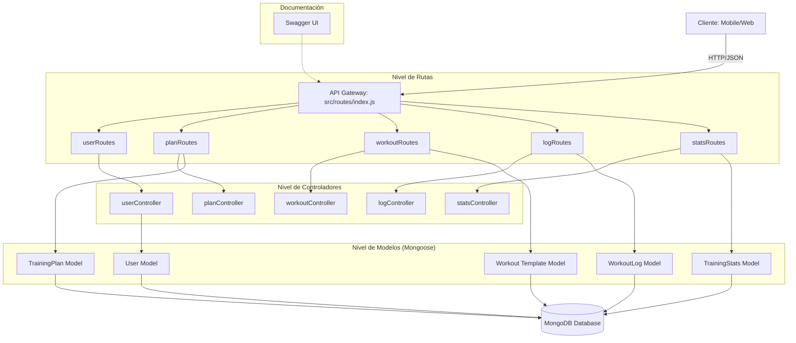
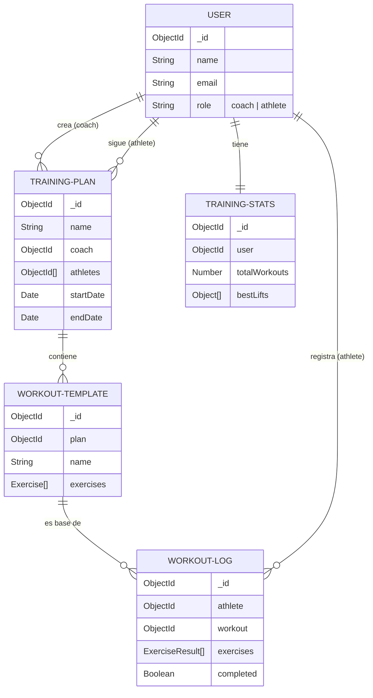

# TFG-EntrenamientoApp-Backend
Repositorio Backend TFG Desarrollo del sistema base y módulo de gestión de entrenamientos para una aplicación móvil de escalada.

## 🚀 Tecnologías
- **Node.js**: Entorno de ejecución.
- **Express**: Framework web.
- **MongoDB**: Base de datos NoSQL.
- **Swagger**: Documentación de la API.
- **Jest & Supertest**: Pruebas unitarias y de integración.

---

## 🏛️ Arquitectura del Sistema
El sistema sigue un patrón MVC (Modelo-Vista-Controlador) adaptado para una API RESTful con Node.js y Express.



---

## 📊 Modelo de Datos (ERD)
El modelo de datos utiliza MongoDB para almacenar planes de entrenamiento maestros y los registros de ejecución de los atletas.



---

## 🛠️ Funcionalidades y Vistas de la API

### A. Gestión de Usuarios y Autenticación
*   **Registro**: `POST /api/users/register` - Permite crear nuevos perfiles (Coach o Atleta).
*   **Perfil**: `GET /api/users/profile/:id` - Obtiene la información detallada del usuario.
*   **Actualización**: `PUT /api/users/profile/:id` - Permite modificar datos del perfil.

### B. Vista del Entrenador (Planificación)
*   **Crear Plan**: `POST /api/training/plans` - Define un nuevo ciclo de entrenamiento.
*   **Gestionar Sesiones**: `POST /api/training/workouts` - Crea plantillas de sesiones dentro de un plan.
*   **Listar Planes**: `GET /api/training/plans/coach/:coachId` - Muestra todos los planes diseñados por un coach.

### C. Vista del Atleta (Ejecución)
*   **Mis Planes**: `GET /api/training/plans/athlete/:athleteId` - Lista los planes asignados al atleta.
*   **Registrar Entrenamiento**: `POST /api/training/logs` - El atleta guarda los resultados reales (peso, series, reps) de una sesión.
*   **Historial**: `GET /api/training/logs/athlete/:athleteId` - Consulta sesiones pasadas.

### D. Vista de Análisis y Estadística
*   **Dashboard**: `GET /api/training/stats/user/:userId` - Resumen de entrenamientos totales y mejores marcas (PRs).
*   **Progreso de Ejercicio**: `GET /api/training/stats/progress/:userId?exercise=Nombre` - Datos históricos para generar gráficas de evolución.

---

## 💻 Configuración Local
1. Copia el archivo `.env.example` a `.env` y configura las variables necesarias.
2. Instala las dependencias:
   ```bash
   npm install
   ```

## 🐳 Ejecución con Docker (Recomendado)
Para levantar el entorno de desarrollo:
```bash
docker-compose -f docker-compose.dev.yml up --build
```

## 🧪 Pruebas
Para ejecutar los tests:
```bash
npm test
```

## 📄 Documentación API
Una vez iniciada la aplicación, puedes acceder a Swagger en:
[http://localhost:3000/api-docs](http://localhost:3000/api-docs)

> [!NOTE]
> Todos los borrados en el sistema se realizan mediante **Soft Delete** (marcado de `isActive: false`) para preservar la integridad referencial y el historial de datos.
